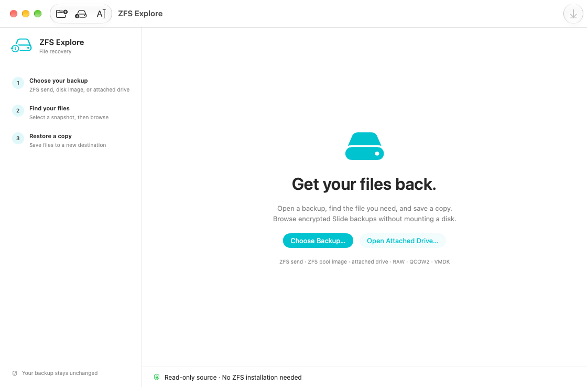
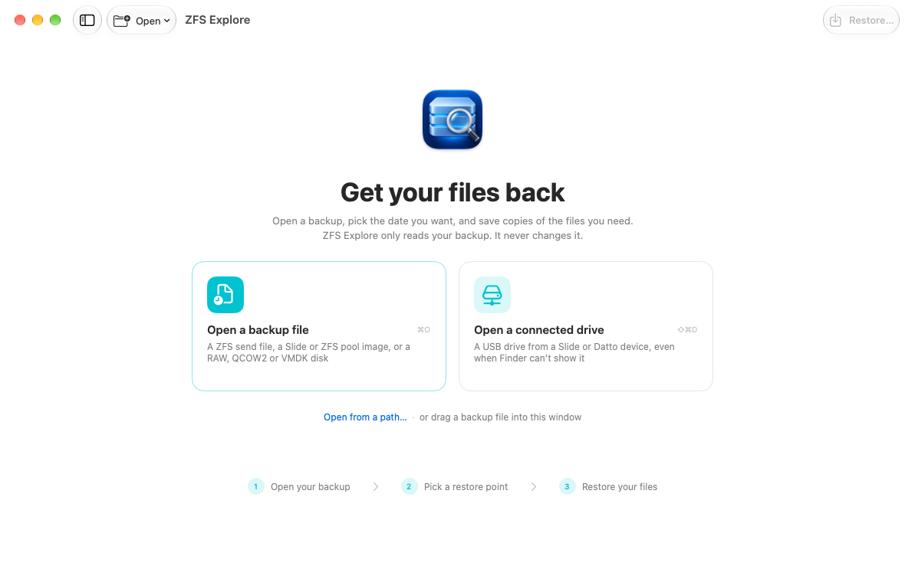
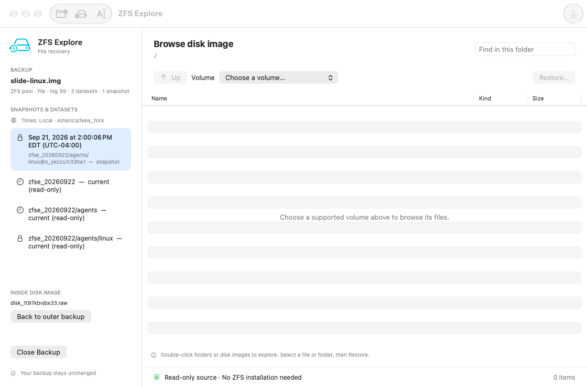
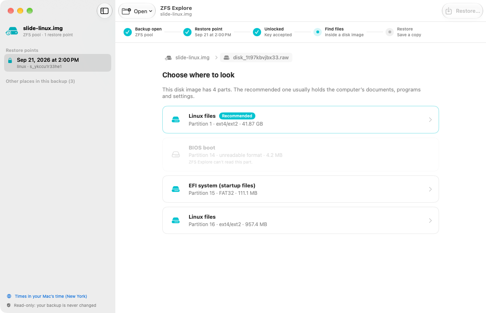
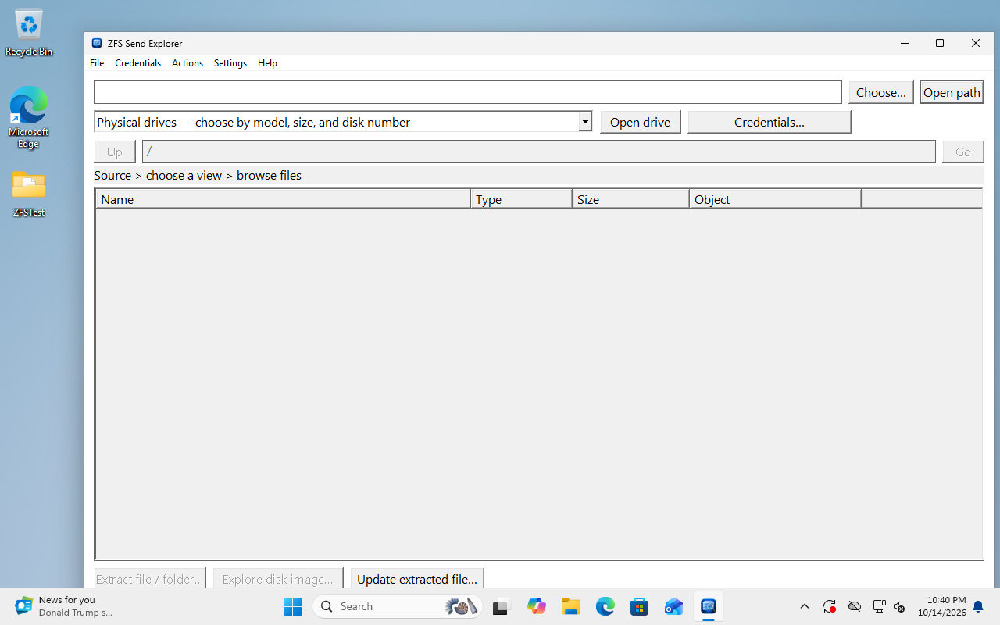
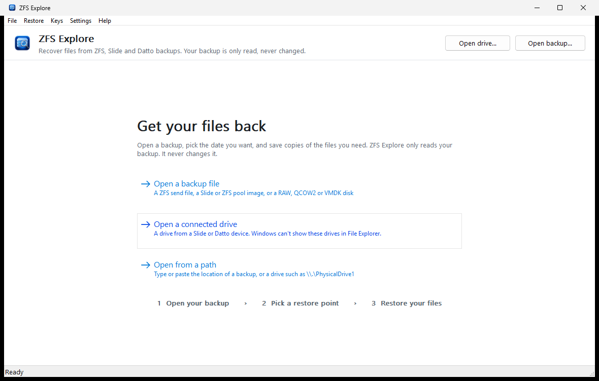
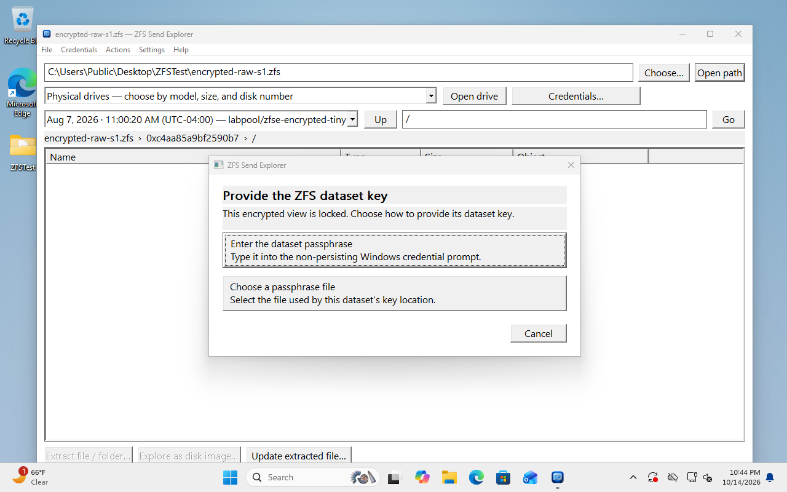
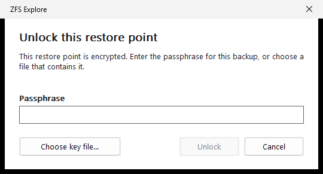

# Desktop visual and usability audit (v0.9.0)

This audit reviewed both desktop apps as a first-time user would meet them:
someone who has a backup file or a drive from a Slide or Datto device, does not
know ZFS vocabulary, and wants one file back. Every screen was exercised against
the public test fixtures and the real encrypted Slide test backup, on macOS 27
(light and dark) and a clean Windows 11 virtual machine at 1280 × 800.

The engine, read-only guarantees and supported formats are unchanged. The work
is about wording, flow and presentation.

## Method

- **Mac:** `scripts/capture-macos-ui.sh` drives the real SwiftUI views through
  the same model and bundled engine, and captures each state from the app's own
  off-screen window. It runs without Screen Recording permission and leaves the
  display alone.
- **Windows:** the release executable ran in an interactive Windows 11 session.
  Screens were captured from the console and checked by hand through the drive
  picker, unlock, restore and error paths.
- **Real backup:** the encrypted Slide Linux test backup was opened, unlocked
  with its key file, its disk image opened, and `/etc/hostname` restored on both
  platforms. The restored bytes were compared with an independent read.

## Findings and changes

Severity: **High** blocks or misleads a novice; **Medium** slows them down or
looks broken; **Low** is polish.

### Both apps

| # | Severity | Finding | Change |
|---|---|---|---|
| B1 | High | ZFS vocabulary everywhere: *dataset*, *view*, *txg*, *stream bytes*, *full/incremental, plain/raw encrypted*, GUID selectors, object numbers, `gpt1`. | Shared plain-language layer (`src/presentation.rs`) used by both apps: "restore point", "full copy", "changes only", "Partition 3 · Windows files · NTFS · 41.9 GB", "Slide backup · 12 restore points". Technical names stay in tooltips and details. |
| B2 | High | The real Slide workflow needs the disk image inside the backup, but nothing says so. Top level shows `agent.json`, `disks.json` and a `.raw` file. | A guidance banner says the computer's files are inside its disk image and offers **Open disk image**. |
| B3 | High | Inside a disk image the user must pick a "volume" from `gpt1 · ext4/ext2 · 41.87 GB`, `gpt15 · FAT32 …` with no recommendation. | The largest readable non-helper partition is marked **Recommended** (EFI, recovery, reserved, swap and BIOS-boot partitions are named and de-emphasised). Windows selects it automatically and explains how to change it. |
| B4 | High | The restore-point list mixes dated snapshots with live dataset heads and empty parent datasets (`zfse_20260922 — current (read-only)`), with no indication which to pick. | The newest restore point with files is selected on open. Dates are compact and relative ("Today, 2:00 PM"). Live heads and parent datasets move to a collapsed *Other places in this backup* group (Mac) or are worded as "live files, not a snapshot" / "holds other backups" (Windows). |
| B5 | Medium | Errors show raw parser output from every reader ("I/O error at stream offset 0 … too small to contain four ZFS labels"). | Friendly headline and next step ("This file isn't a backup ZFS Explore can open …") with the original text under **Show details**. |
| B6 | Medium | Product name differs: *ZFS Explore* (Mac) and *ZFS Send Explorer* (Windows). | Both apps are **ZFS Explore**. Windows settings keep their existing folder so preferences carry over. |
| B7 | Low | Sizes such as "Zero KB" and "67108864 bytes". | Consistent human sizes on both platforms. |

### macOS

| # | Severity | Finding | Change |
|---|---|---|---|
| M1 | High | Toolbar buttons were unlabeled icons; *Open Path* (`text.cursor`) reads as "AI". | Labeled **Open** menu (backup file, connected drive, path, close) and **Restore…** toolbar button. |
| M2 | High | The three-step guide disappeared once a backup opened, so the user lost their place. | A step bar shows *Backup open → Restore point → Unlock → Find files → Restore*, with the chosen date and what is done. |
| M3 | Medium | Unlocking needed a sheet on top of an explanation screen; key wording referred to datasets and hexadecimal. | Inline unlock: masked field, **Unlock**, **Choose Key File…**, wording matched to the key format ("Paste the 64-character encryption key from your Slide console …"). Wrong keys say so plainly. |
| M4 | Medium | Location was a monospaced path plus an **Up** button; leaving a disk image used a separate sidebar button. | Clickable breadcrumb: backup › disk image › folders. Any level is one click away. |
| M5 | Medium | Sidebar content shifted horizontally depending on its width; branding repeated the window title. | Native `NavigationSplitView` sidebar (hidden on the welcome screen) with a backup summary, restore points and one read-only reassurance. |
| M6 | Medium | Restore results led with a temporary path and SHA-256. | "Restored “hostname”" banner: count, size and folder, **Show in Finder**, details on request. Save panel starts on the Desktop. |
| M7 | Low | Two equal-weight buttons and a format list on the welcome screen; no drag and drop. | Welcome cards for *Open a backup file* and *Open a connected drive*, a path link, drag-and-drop anywhere in the window, and a three-step summary. |
| M8 | Low | Busy state was only a small spinner in a status bar. | A centred progress card appears for operations longer than a moment. |
| M9 | Low | Time zone sheet used the system accent instead of the app's teal; button text "Times: Local · America/New_York". | Footer link "Times in your Mac's time (New York)"; sheets use the app tint. |

The Mac app now requires macOS 14 or later.

### Windows

| # | Severity | Finding | Change |
|---|---|---|---|
| W1 | High | **Visual styles never loaded.** `zfs-send-explore.rc` used the name `RT_MANIFEST` without including `windows.h`, so the manifest was stored as a custom resource type and ignored. Controls drew in the classic style, task dialogs fell back to a home-made dialog with grey bands and clipped text, and the manifest's long-path and DPI settings did not apply. | The manifest uses resource type `24`. Common Controls 6, native task dialogs and long-path support now work. |
| W2 | High | First screen: an empty path box and seven equal buttons (*Choose…, Open path, Open drive, Credentials…, Up, Go, Update extracted file…*) with no indication of where to start. | A welcome page with three large command links: *Open a backup file*, *Open a connected drive*, *Open from a path*, plus the three-step summary. Expert actions moved to menus. |
| W3 | High | Encrypted backups opened a chooser, then the legacy Windows credential dialog asking for a *User name* and *Password*. | One **Unlock** dialog with a masked field, **Choose key file…** and format-specific wording. The field is cleared before the dialog closes. |
| W4 | High | The window (760 px) was taller than a 1280 × 800 screen's work area, hiding the status bar behind the taskbar; fonts were a fixed pixel size at every DPI. | Window size is clamped to the work area and centred; fonts are created for the monitor's DPI and recreated when it changes. |
| W5 | Medium | Physical drives sat in an always-visible combo box; the Windows system disk looked like any other drive. | **Open drive…** shows a native chooser with model, size and type; the computer's own Windows disk is labelled and needs a second confirmation. |
| W6 | Medium | Raw object numbers in an *Object* column and no file icons. | Explorer-style list with shell icons, a drive icon for disk images, *Name / Type / Size* columns and a description of the selected item. |
| W7 | Medium | Completion was a message box with a SHA-256 and a note about "update metadata". | "Restored “hostname”" task dialog with **Show in File Explorer**; hash and the `.zfse.json` explanation under details. |
| W8 | Low | Menus were *File, Credentials, Actions, Settings, Help*, with expert items first. | *File, Restore, Keys, Settings, Help*, a **How to restore files** page and an up-to-date shortcut list (Ctrl+S restores, Ctrl+W closes). |

## Screens

Mac screenshots are produced by `scripts/capture-macos-ui.sh`; Windows
screenshots by `scripts/capture-windows-ui.ps1`.

| Before | After |
|---|---|
|  |  |
|  |  |
|  |  |
|  |  |

## Not changed

- Formats, read-only behaviour, overwrite refusal (Mac) and the save dialog's
  replace confirmation (Windows), key handling in zeroizing memory.
- Windows remains unsigned; SmartScreen may warn on first run.
- Datto passphrase and agent-password entry remain Windows and CLI features.
