# ZFS Explore for Windows

`zfs-send-explore-windows.exe` (window title **ZFS Explore**) is the native Windows recovery client for ZFS send files, Slide Boxes, Datto Reverse RoundTrip drives, exported pool members, and standalone disk images. It does not install ZFS, `cryptsetup`, a filesystem driver, or mount a source. It can browse and extract one file or a staged directory tree, descend through disk images recursively, and advance a previously extracted ZFS file with a matching incremental send.

The executable uses the same checked stream, encryption, pool, extraction, sparse-file, and update library as `zfs-send-extract`. It does not shell out to the CLI and it does not require `libzfs` or a filesystem driver.

> [!IMPORTANT]
> This is experimental recovery software. Keep the original send file or pool member until the recovered file has been independently checked. Pool sources are opened read-only, but a pool member must still be exported or otherwise stable before it is examined.

The screenshots in this guide were captured from the real x86-64 executable on Windows 11 Pro, not from a mock-up.

## Before you start

You need:

- Windows 10 or Windows 11 on x86-64;
- `zfs-send-explore-windows.exe` from a release package or a local build;
- a ZFS send file, vdev image, whole-disk image, or exported physical member; and
- enough free space for the file being extracted. Sparse files need space for allocated ranges, not necessarily their full logical size, when the destination supports sparse files.

Administrator rights are not needed for ordinary send files and image files. Start ZFS Explore with **Run as administrator** only when opening a drive such as `\\.\PhysicalDrive1` and Windows denies normal raw-disk access.

If a release publishes a checksum, verify it before first use:

```powershell
Get-FileHash .\zfs-send-explore-windows.exe -Algorithm SHA256
```

## Window tour

The client uses Win32 common controls with Windows visual styles, native task
dialogs, Windows open/save dialogs, Segoe UI sized for each monitor's DPI, and
Explorer-style file icons. Long scans and restores run on background workers so
the window keeps responding.

When nothing is open, the window shows three large choices and a summary of the
steps:


- **Open a backup file** (Ctrl+O) — a ZFS send file, a Slide or ZFS pool image,
  or a RAW, QCOW2 or VMDK disk image. The format is detected automatically.
- **Open a connected drive** (Ctrl+D) — a drive from a Slide or Datto device.
- **Open from a path** — type or paste a location, including `\\.\PhysicalDriveN`.

Once a backup is open:

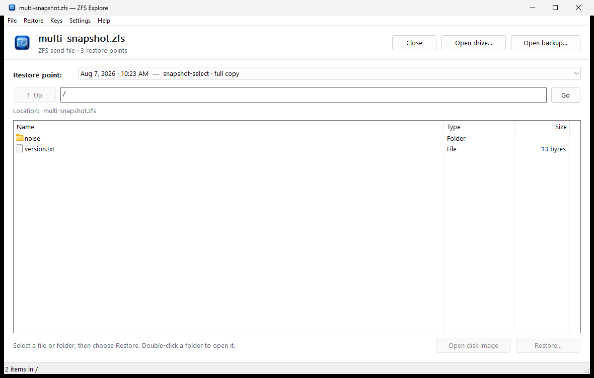

1. **Header** — the backup's name and what it is ("Slide backup · 12 restore
   points"), with **Close**, **Open drive…** and **Open backup…**.
2. **Restore point** — the newest restore point that holds files is selected
   automatically. Each entry shows its date, the backup it belongs to and how it
   was captured ("full copy", "changes only", "live files, not a snapshot").
3. **Part of the disk** — appears inside a disk image. The recommended part (the
   largest readable partition that isn't a helper partition) is chosen for you.
   **Back to the backup** leaves the disk image.
4. **Up**, the folder box and **Go** — type a path such as `/etc` and press
   **Enter**, or use Ctrl+L to jump to the box. **Location** shows where you are.
5. **Guidance bar** — appears when there is an obvious next step: unlocking an
   encrypted restore point, or opening the disk image that holds a protected
   computer's files.
6. **File list** — folders first, with Explorer icons, type and size.
   Double-click or press **Enter** to open a folder or disk image.
7. **Selection line, Open disk image and Restore…** — describe and act on the
   selected item.

The menus hold the same actions plus Datto keys, settings and
**Help › How to restore files**.

## Open a backup and pick a restore point

1. Choose **Open backup…** and select the file. The app recognizes send files,
   pool images and disk images automatically.
2. The newest restore point is selected and its top folder is listed. Choose an
   earlier date in **Restore point** if you need an older copy.
3. Double-click folders, use **Up** (Alt+Up or Backspace), or type a path and
   press **Enter**.

A send-file restore point is browseable only when the file also contains its
complete history back to a full copy; a standalone incremental ("changes only")
does not contain the base files. Restore point times use this computer's time
zone unless you choose another under **Settings › Restore point time zone**.

## Open standalone and nested disk images

Disk images open without exporting, attaching or mounting anything. Every read
stays positioned in the original source.

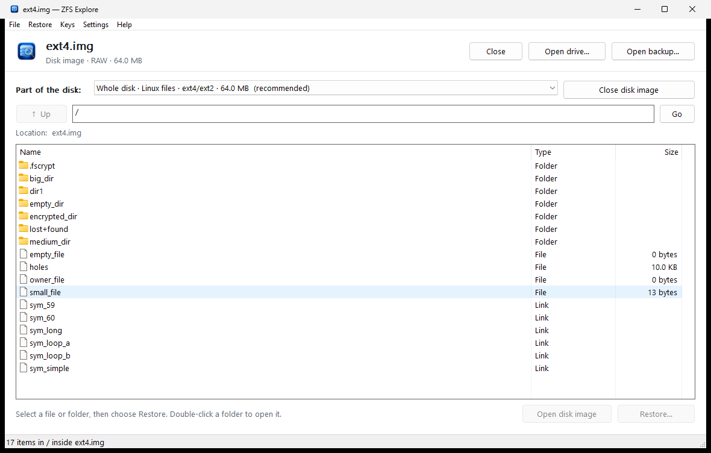

1. Open the image directly with **Open backup…** (or **File › Open disk image
   file…**, Ctrl+Shift+O), or select an image inside a backup and choose **Open
   disk image** (Ctrl+I). For Slide and Datto backups, the guidance bar offers
   the computer's disk image directly.
2. **Part of the disk** selects the recommended partition. Choose another part
   if your files aren't there; helper partitions such as EFI, recovery and swap
   are named so they are easy to skip.
3. Browse and restore as usual. Images inside the image can be opened again, up
   to eight levels.
4. Choose **Back to the backup** (or press **Esc**) to return one level with the
   previous folder and part restored.

If an image is embedded inside a larger file, enable **Settings › Show advanced
disk-image range fields**, enter its byte offset and optional length, and open
it again. The app offers this directly when an image can't be opened.

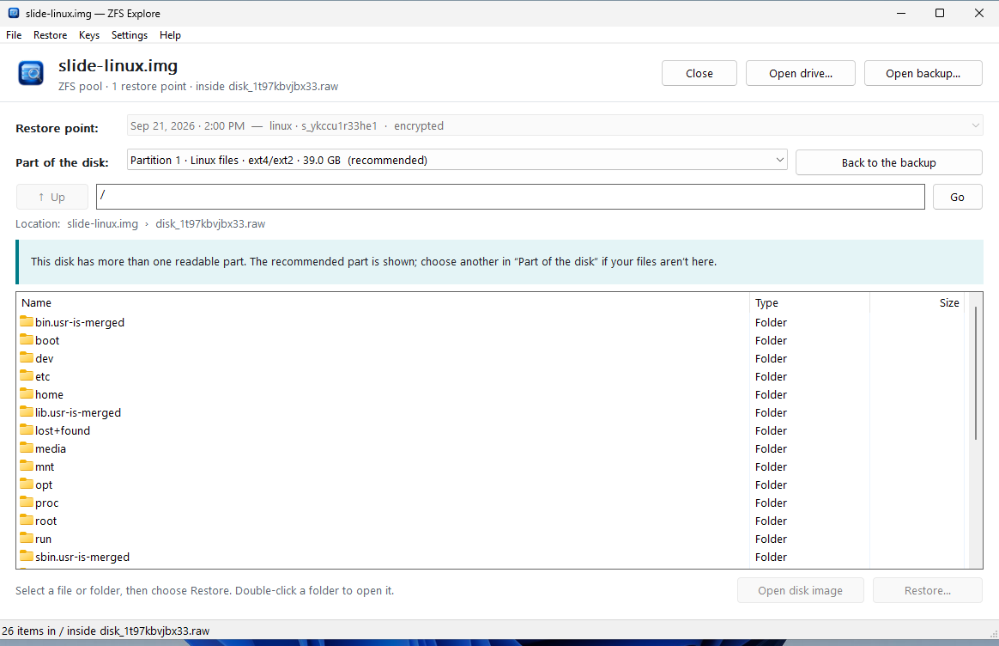

The GUI recognizes:

- raw and sparse images, including an unpartitioned filesystem;
- self-contained QCOW2 v2/v3 images;
- self-contained VMDK `monolithicSparse` images;
- CRC-validated GPT, with primary/backup recovery and 512- or 4096-byte logical sectors;
- MBR primary and extended/logical partitions; and
- NTFS, FAT12/16/32, exFAT, ext4, and compatible ext2 subordinate filesystems.

Sources and all inner layers remain read-only. Nested file reads are served on demand through the active filesystem; a multi-terabyte child image is not materialized just to inspect its partitions. A file restored from inside an image is built in a same-directory sparse temporary file, synchronized, hashed with SHA-256, and moved into place only after success. It receives no `.zfse.json` sidecar because it is not a directly addressable ZFS object.

QCOW1, QCOW2 backing-file overlays and encryption, split/flat/stream-optimized VMDKs, EFS-encrypted files, and non-UTF-8 ext names are rejected. ext symlinks are visible but are not followed. A dialog explains an unsupported layer instead of falling back to a potentially incorrect raw interpretation.

## Restore a file or folder

1. Select a file or folder in the list.
2. Choose **Restore…** (Ctrl+S). Double-clicking a regular file also restores it.
3. Choose where to save the copy. The save dialog starts on the Desktop the
   first time; confirm a replacement only if you intend to overwrite that file.
4. The result names the copy and offers **Show in File Explorer**. **Show
   details** reveals the SHA-256 and whether update information was saved.

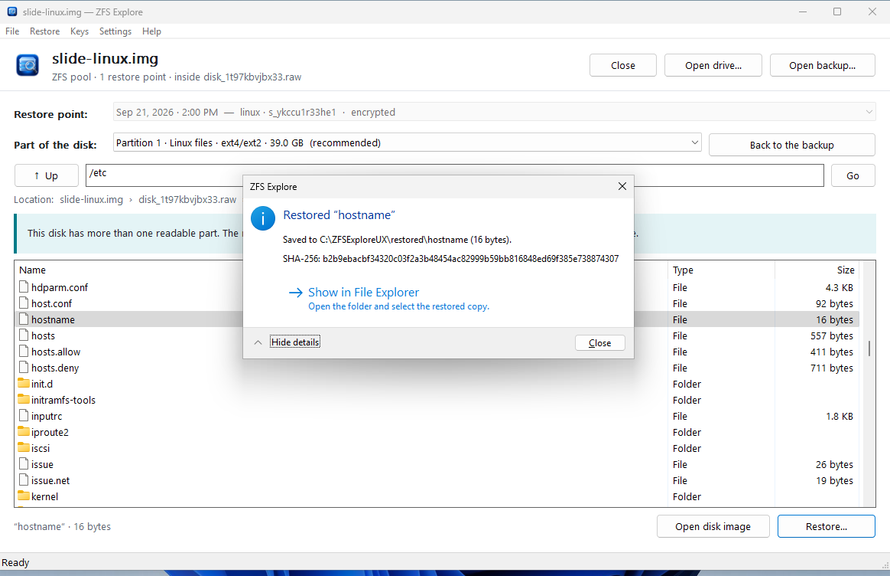

A restore is built in a temporary file in the destination directory. The result is synchronized and moved into place only after replay and hashing finish. A failed operation leaves the requested destination unchanged.

A folder is built in a unique staging directory beside its destination. The
new tree is published only after every regular file succeeds. Confirming an
overwrite first moves the previous tree into that staging directory, publishes
the new tree, and then removes the replaced tree. Symlinks and unsupported
special entries are never followed. Recursive restore recreates directory
names and regular-file bytes, but not ACLs, ownership, permissions, alternate
NTFS streams, or other filesystem metadata.

A restore from a named send or pool snapshot also writes a sidecar beside the file:

```text
only-s2.txt
only-s2.txt.zfse.json
```

The sidecar records the source path, DMU object identity, base snapshot GUID, logical size, and SHA-256 needed for a later incremental update. It does not contain an encryption key. Keep the file and sidecar together and do not edit the sidecar.

A restore from a current pool dataset head, or from inside a disk image, has no
update-eligible sidecar because it is not a stable incremental-send base.

## Unlock an encrypted restore point

Snapshot names stay visible in raw sends and native-encrypted pools; paths and
contents need the key. When you pick an encrypted restore point, the **Unlock
this restore point** dialog opens immediately:


- Paste or type the key and choose **Unlock**. The wording matches the key
  format: Slide's 64-character key for `keyformat=raw`, the 64-character key for
  `hex`, or the passphrase.
- Or choose **Choose key file…** for a 32-byte raw key, a 64-character text
  file or a passphrase file.
- If you cancel, the guidance bar keeps an **Unlock…** button (Ctrl+K).

A wrong key is reported plainly and the dialog opens again; the interrupted
browse or open is retried after a new key. The field is masked and cleared
before the dialog closes. Entered keys and loaded key files are kept only in
zeroizing process memory, scoped to the backup and restore point, and never
written to settings or `.zfse.json`. **Keys › Forget all keys** closes the open
backup and releases every retained key.

Datto drive passphrases and agent passwords use the same dialog (see below) and
are also available from the **Keys** menu.

Authentication tags, encrypted metadata, block tags, spill blocks, and supported indirect authentication state are verified before plaintext is used. Native-encrypted pools additionally verify inherited encryption-root discovery, wrapped keys, the objset portable MAC, encrypted dnode bonuses, and folded physical checksums.

## Browse an attached drive or whole-disk image

### Prepare the source safely

Use an exported pool member, a detached drive, or a stable image. Do not browse a member that belongs to a pool which is currently imported and changing. A selected uberblock can otherwise refer to blocks that are freed and reused during traversal.

For a physical drive:

1. Attach the disk without initializing, formatting, or assigning it a Windows filesystem.
2. Choose **Open drive…** (Ctrl+D). Each drive is listed with its disk number,
   model, size and type; the computer's own Windows disk is labelled and asks
   for a second confirmation. Choose **Refresh the list** after connecting a drive.
3. Choose the drive. It opens read-only.
4. If Windows reports that access was denied, close ZFS Explore, right-click it,
   choose **Run as administrator**, and open the drive again.

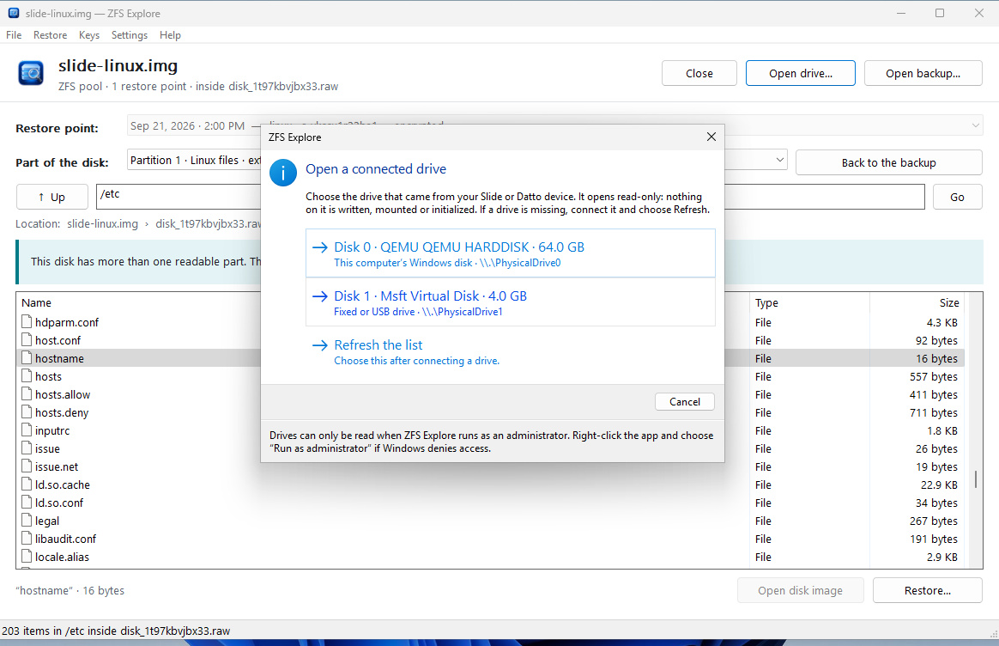

For an independent cross-check, PowerShell reports the same disk numbers:

   ```powershell
   Get-Disk | Format-Table Number, FriendlyName, PartitionStyle, OperationalStatus, Size, IsReadOnly
   ```

Never guess the disk number. Refresh after attaching or removing storage because Windows numbering can change. Power users may type an exact `\\.\PhysicalDriveN` path in **File › Open from a path…**; by default a typed drive path asks for confirmation.

The source is opened read-only. The backend checks the source for all four ZFS vdev labels. If no labels are valid at the whole-disk level, it validates GPT or bounded MBR metadata and probes non-empty partitions as read-only slices. A LUKS1/LUKS2 partition is unlocked in userspace when the Datto pool key has been selected, then probed for ZFS labels without creating a Windows block device. Exactly one ZFS-bearing payload is selected automatically; multiple candidates are rejected.

The tested raw member below was attached to Windows as read-only `PhysicalDrive1`:

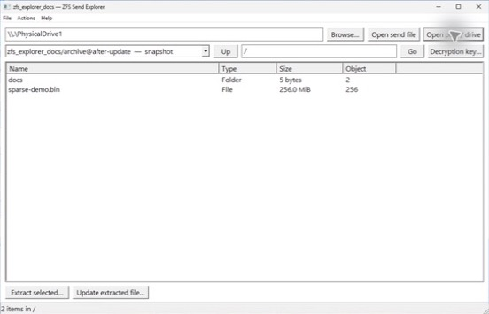

Named snapshots appear before current dataset heads. Current heads are described as "live files, not a snapshot" and can be restored, but they do not produce update metadata.

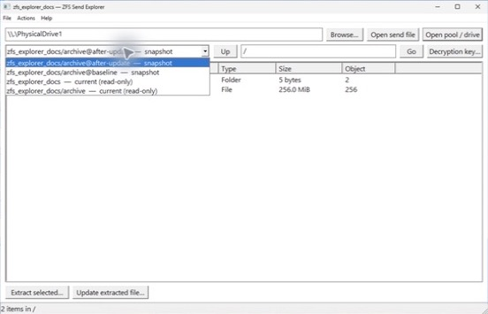

Direct pool support is intentionally conservative:

- one top-level disk or file vdev;
- one healthy leaf from one top-level mirror;
- plaintext or native-encrypted little-endian ZFS filesystem datasets; and
- the checksum, compression, ZAP, System Attribute, and indirection profiles listed in the main README.

RAIDZ/dRAID, several top-level vdevs, encrypted big-endian pools, special/dedup allocation classes, device-removal maps, gang blocks, and ZVOL file browsing are rejected. A send file can still be used when the direct member reader cannot assemble the pool layout.

## Recover a Slide Box

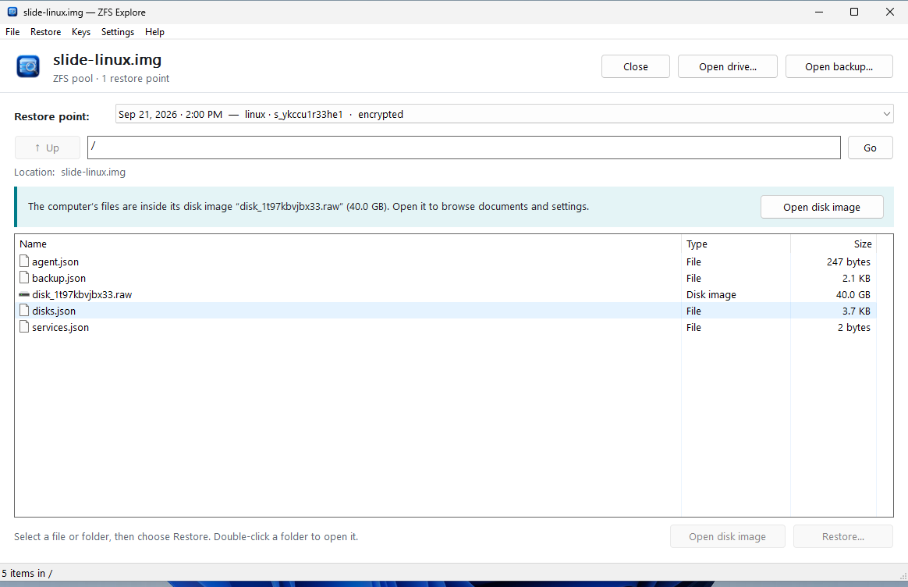

1. Connect the Slide Box drive and choose **Open drive…**, or open a Slide pool
   image with **Open backup…**.
2. The newest restore point of the protected computer is selected.
3. In **Unlock this restore point**, paste Slide's 64-character key or choose its
   key file.
4. The guidance bar says the computer's files are inside its disk image; choose
   **Open disk image**.
5. The recommended part of the disk is selected. Browse to the file or folder
   and choose **Restore…**.

The current direct-pool constraints still apply. A Slide Box using RAIDZ or
several top-level vdevs cannot yet be reconstructed from multiple members.

## Recover a Datto Reverse RoundTrip drive

1. Connect the drive and choose **Open drive…**. If it is LUKS-protected, the
   **Unlock the Datto drive** dialog asks for its passphrase (or passphrase
   file) and the drive opens automatically afterwards.
2. The app detects GPT or MBR, unlocks the LUKS payload internally, and labels a
   `revRT-*` pool as a Datto backup drive.
3. Choose the protected system's restore point under `POOL/home/agents/AGENT_GUID`.
4. For `.datto`, open the image from the guidance bar or with **Open disk image**.
5. For `.detto`, **Unlock the Datto disk image** asks for the agent password (or
   its text file) when the image is opened. A rejected password asks again and
   retries the image.

For `.detto`, the app finds the single `config/*.encryptionKeyStash` file,
authenticates it with the supplied password, derives the 64-byte AES-XTS key,
and decrypts requested sectors on demand. Pool and agent passwords are distinct
roles and neither is passed to an external executable. No decrypted disk image
is materialized on the host.

## Sparse-file behavior

Sparse handling is automatic; there is no checkbox to enable it.

- Windows destinations are marked sparse with `FSCTL_SET_SPARSE`.
- Unwritten ZFS blocks and zero replay ranges remain holes.
- Freed ranges use `FSCTL_SET_ZERO_DATA` on sparse-capable Windows filesystems.
- Updates use `FSCTL_QUERY_ALLOCATED_RANGES` so copying the base file does not expand existing holes.
- The logical SHA-256 still includes every zero byte in a hole.
- If the destination does not support sparse controls, the logical bytes remain correct but zero ranges may consume physical space.

The attached-drive test extracted a file with a 256 MiB logical size and data only at its beginning and end:

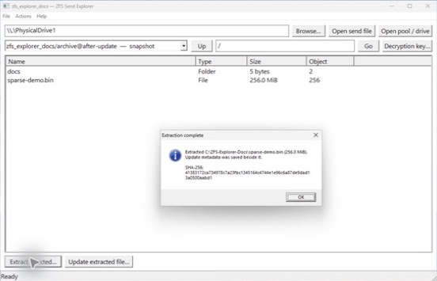

Windows reported the result as `Archive, SparseFile`. Its two allocated ranges were each 128 KiB, for 256 KiB allocated versus 256 MiB logical. Both boundary markers were verified after extraction:

```text
Head: ZFS-SPARSE-START
Tail: ZFS-SPARSE-END
Allocated range 1: offset 0x0,       length 0x20000
Allocated range 2: offset 0xffe0000, length 0x20000
```

You can inspect a recovered sparse file with:

```powershell
Get-Item .\sparse-demo.bin | Format-List Length, Attributes
fsutil sparse queryrange .\sparse-demo.bin
```

Allocated range sizes are rounded to the filesystem's allocation behavior and can differ by destination volume.

## Update a previously restored file

An incremental send describes changes by base snapshot and DMU object number, not by a recoverable pathname. Therefore the target must first be extracted from the matching named base snapshot by this tool.

Prerequisites:

- the extracted file is still byte-for-byte unchanged;
- its `.zfse.json` sidecar is beside it;
- the update source is a standalone incremental send whose `fromguid` matches the sidecar; and
- the same key is available when applying a raw encrypted incremental.

To update:

1. Choose **Restore › Update a restored file from an incremental send…** (Ctrl+U).
2. Choose the previously extracted target. The dialog makes its adjacent sidecar visible for confirmation.

   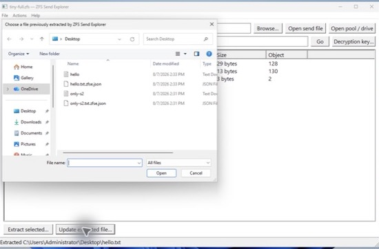

3. Choose the matching incremental ZFS send file.

   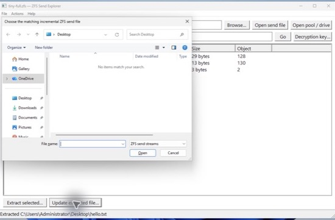

4. Wait for **The restored file is up to date**, which reports the new snapshot GUID, logical size, and SHA-256.

   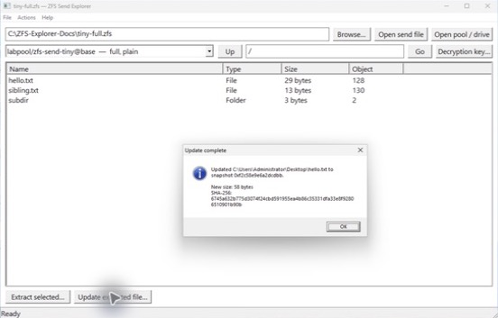

Before replacement, the client verifies:

- the target's current logical size and SHA-256;
- the incremental stream's `fromguid` against the sidecar snapshot GUID;
- the stable DMU object and required bonus/spill metadata;
- replay-record and stream checksums; and
- for raw encrypted sends, key identity, block tags, authenticated metadata, spill data, and updated dnode-range authentication.

The target is copied into a same-directory sparse temporary file. Matching `OBJECT`, `WRITE`, `WRITE_EMBEDDED`, `FREE`, and `SPILL` records are replayed there. Only a successful and synchronized result replaces the target and advances the sidecar. A local edit, wrong base, deleted/recreated object, unsupported replay feature, or authentication failure leaves the original target untouched.

## Keyboard shortcuts and settings

| Shortcut | Action |
| --- | --- |
| **Ctrl+O** | Open a backup file (format detected automatically) |
| **Ctrl+D** | Open a connected drive |
| **Ctrl+Shift+O** | Open a disk image file |
| **Ctrl+W** | Close the backup |
| **Ctrl+K** | Unlock this restore point (or a selected `.detto` image) |
| **Ctrl+L** | Go to a folder (focus the folder box) |
| **Enter** | Go to the typed folder; open the selected folder or disk image; restore another file |
| **Alt+Up** or **Backspace** | Go up one folder |
| **Ctrl+I** | Open the selected file as a disk image |
| **Esc** | Leave the current disk image |
| **Ctrl+S** or **Ctrl+E** | Restore the selected file or folder |
| **Ctrl+U** | Update a restored file from an incremental send |
| **F5** | Refresh the current folder |

The **Settings** menu persists to `%APPDATA%\ZFS Send Explorer\settings.json`
(the folder keeps its earlier name so preferences carry over). It controls
disk-image double-click behavior, forgetting keys when another backup opens,
confirmation for typed drive paths, the advanced disk-image range fields and
the restore point time zone. Window size is restored and clamped to the screen.
The settings file contains no keys, passwords, source contents, or recovery
metadata.

## Troubleshooting

| Symptom | What to check |
| --- | --- |
| "Windows didn't allow ZFS Explore to read this" for a drive | Start ZFS Explore with **Run as administrator**, confirm the disk number, and close utilities that hold the raw device exclusively. |
| **No readable ZFS vdev label** | Confirm the pool was exported, the correct member or image was selected, and its layout is supported. For a whole disk, confirm that exactly one partition contains the intended vdev. |
| The restore point remains locked | Choose **Unlock…** in the guidance bar or press **Ctrl+K**. Paste the 64-character key or choose the key file. |
| The view is incremental but cannot be browsed | The send file is missing its full base or an earlier incremental in the ancestry chain. Use a self-contained history file. |
| **Extraction metadata** cannot be opened | Keep `<file>.zfse.json` beside the extracted file, or re-extract from the named base snapshot. |
| Target hash or size differs | The extracted file was changed locally. Preserve it and re-extract a clean base before applying the incremental. |
| Incremental `fromguid` does not match | The chosen incremental starts from another snapshot. Select the send whose base is the sidecar's snapshot. |
| A current pool head cannot be updated | Re-extract the file from a named snapshot so a stable base GUID and sidecar can be recorded. |
| "ZFS Explore can't look inside this file" | Use the offered **Restore the image file instead** or **Set an advanced image range** action; CLI `inception inspect` provides per-volume diagnostics. |
| A valid filesystem starts after an appliance header | Choose **Set an advanced image range**, enter its exact byte offset and optional length, then choose **Open disk image** again. |
| QCOW or VMDK reports an unsupported feature | Use a self-contained QCOW2 v2/v3 or VMDK `monolithicSparse` image. Backing files and external/split VMDK extents are not guessed or searched for. |
| An inner NTFS file cannot be restored | Standard NTFS LZNT1 compression is supported. EFS encryption remains unsupported; select an unencrypted unnamed `$DATA` stream. |
| Sparse extraction has the right length but consumes full space | The destination filesystem may not support Windows sparse controls, or a storage layer may materialize holes. Logical content remains authoritative. |
| An older build reports **Incorrect function** for a raw drive | Update to a build containing the Windows physical-drive length probe; ordinary file metadata calls do not work for every raw device handle. |

Problems are explained in plain words; **Show details** in the dialog reveals the underlying operation context. The CLI can be used to reproduce most send-file or image-file failures in a terminal when more scripted diagnostics are useful.

## Build and package

Building natively requires Rust 1.87 or later, the stable MSVC target, and a Windows SDK/Visual Studio Build Tools installation:

```powershell
rustup default stable-x86_64-pc-windows-msvc
cargo test --all-targets
cargo build --release --bin zfs-send-explore-windows
.\scripts\package-windows.ps1
```

The executable is written to:

```text
target\release\zfs-send-explore-windows.exe
```

The packaging script creates:

```text
target\windows-package\zfs-send-explore-windows-x86_64.zip
```

The native build embeds `packaging/windows/zfs-send-explore-windows.exe.manifest`. It requests Common Controls 6, per-monitor V2 DPI behavior, Windows 10/11 compatibility, long paths, and `asInvoker` execution. Ordinary send work therefore does not trigger elevation; use **Run as administrator** only for a raw physical drive when required.

The app also embeds its full-resolution icon inside the executable. Explorer,
taskbar and large/small window icons use this resource; no adjacent `.ico` file
is required when moving the portable executable.

## Screenshot validation record

The v0.9.0 screenshots were captured from the optimized x86-64 MSVC executable
on Windows 11 Pro (build 26100) at 1280 × 800 and 100% scale:
`scripts/capture-windows-ui.ps1` captures the welcome page, a send file, the
unlock dialog and an unlocked restore point, and a standalone ext4 image; the
Slide, drive-picker and restore screens come from an interactive session using
the public encrypted Slide test backup and a read-only virtual disk containing
it. Both the file and drive restores of `/etc/hostname` matched an independent
OpenZFS/ext4 read (SHA-256 `b2b9ebacbf34320c03f2a3b48454ac82999b59bb816848ed69f385e738874307`).
The full findings are in the [desktop UX audit](desktop-ux-audit.md).

Older screenshots in this folder remain as historical evidence for incremental
updates, sparse extraction and the v0.5 interface described in the
[v0.5 UI review](windows-ux-review.md).

## Snapshot dates

Pool snapshots are newest first and show their recorded creation time. Choose
**Settings → Snapshot time zone** for this computer's local time (the default),
UTC, or a named zone grouped by region. This preference is saved in the existing
settings file. Changing it updates the labels while preserving the selected
snapshot and current directory. Original snapshot IDs remain in the labels,
and UTC offsets distinguish repeated daylight-saving hours.
